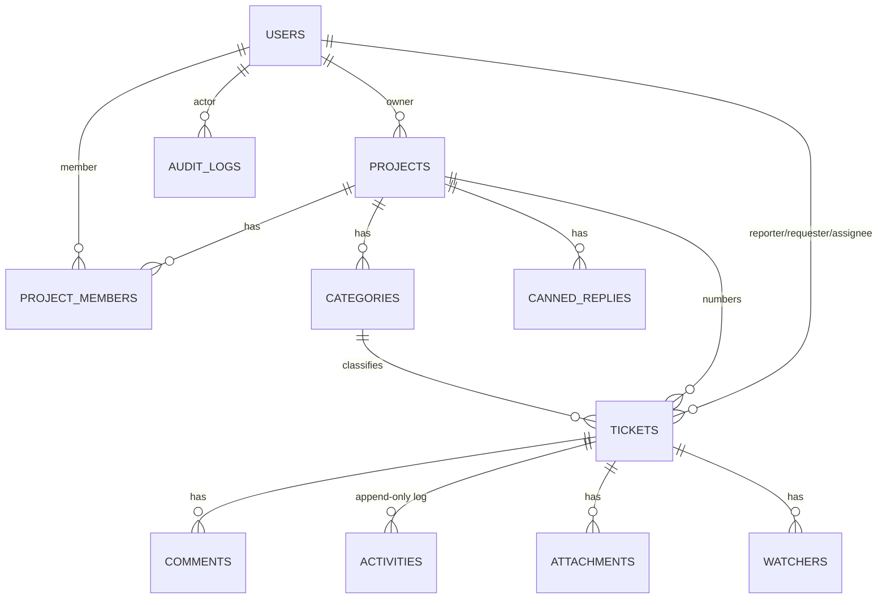

# Architecture

Modular monolith. Keep controllers and Livewire components thin; business rules live in `app/Actions` and `app/Domain`.

## Request flow

```
Browser --HTTPS--> nginx --fastcgi--> php-fpm (app)
                          |-- Redis: sessions, cache, queues, broadcasts (Reverb)
                          |-- PostgreSQL 16: all business data
Horizon (worker) <--- Redis queues: default, notifications, mail-ingest, reports
Scheduler -------> SLA checks, snapshots, cleanup (later phases)
```

## Layers

| Directory | Purpose |
|---|---|
| `app/Actions` | Single-purpose, transactional write operations |
| `app/Domain` | Enums, numbering, workflow, status mapping, ranking (pure where possible) |
| `app/Http/Requests` | FormRequests + shared validation rules for every input |
| `app/Policies` | Authorization; global scope `VisibleToUserScope` is defence in depth |
| `app/Observers` | Append-only activity logging, first-response timestamp |
| `app/Services` | TOTP, markdown sanitisation, attachment validation, audit |
| `app/Livewire` | Inline editing, quick create, ticket detail, lists |
| `database/migrations` | All schema; every migration has `down()` |

## ERD (Phase 1)



## Helpdesk flow (Phase 2)

```
Action (create / comment / status / assign)
   -> domain event -> queued listener -> NotificationDispatcher (60s debounce, preferences)
   -> SendDebouncedTicketNotification -> TicketEventNotification (mail, database, broadcast)
```

Full-text search uses a `tsvector` column on tickets maintained by triggers over ticket text and public/private comments (weight A/B/C). Search queries are scoped by the same `VisibleToUserScope` as normal ticket queries; results are paginated at 25 and exact keys sort first.

## Key invariants

- Ticket keys are `{PROJECT_KEY}-{number}`; numbers come from an atomic `UPDATE ... RETURNING` inside a transaction.
- Requesters are restricted by a global scope **and** policies; agents only see projects they belong to; admins see all.
- Markdown is rendered through one sanitising service (CommonMark + HTMLPurifier). Attachments are never public.
- Global roles: `requester`, `agent`, `admin`. Project roles: `lead`, `member`.
- All timestamps stored UTC, displayed in `Asia/Jakarta`, via Carbon.

## SLA (Phase 3)

`SlaService` loads `settings` + `holidays` into a pure `SlaConfiguration`, then `SlaCalculator` computes due dates and paused business time. `CheckSlaJob` (every minute, `onOneServer`) writes idempotent `sla_events` and dispatches queued notifications.
